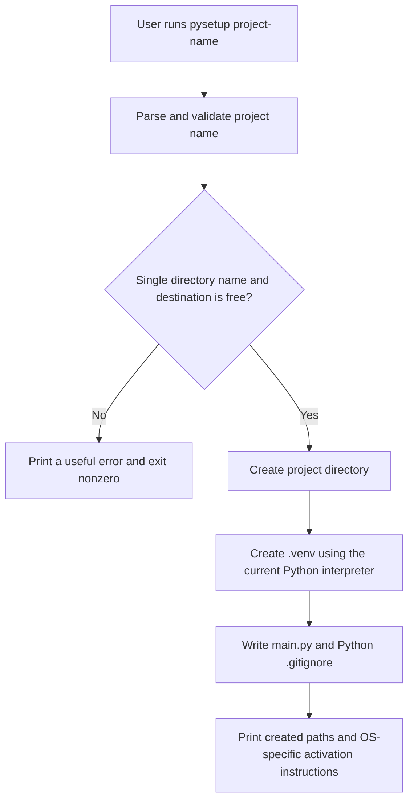

# `pysetup` — Python Project Starter

> Creates a project folder, virtual environment, starter Python file, and `.gitignore` with a single command.
> Example: `pysetup myproject`

**Team:** Swapnil Gaur , Prajwal Mali  
**Repository:** https://github.com/SwapnilGaur05/pysetup-Python-Project-Starter  
**Date:** 27-10-2026

---

## 1. The problem

Starting a small Python project means repeating the same setup steps: create a folder, enter it, create a virtual environment, add a starter file, and remember a Python `.gitignore`. These are simple steps, but forgetting one can leave a project inconsistent or cause generated files to be committed.

### Current manual setup

> Confirm or edit this sequence to match the commands you actually type.

```bash
mkdir myproject
cd myproject
python3 -m venv .venv
touch main.py
```

> Add the command you use to create or copy your `.gitignore`, if you have one.

### Evidence from our machines

> Run this command in the shell you normally use and paste its actual output. Shell history may not contain commands from every terminal session.

```bash
history | grep -E 'python3? -m venv|mkdir .*project' | wc -l
```

```
[Paste your real output here.]
```

> Add two sentences here: how often you set up a Python project and how much time or effort the repeated steps cost you.

### Who else has this problem

> Ask at least one classmate or teammate whether they repeat these setup steps. Record who you asked and what they said; do not assume everyone has the same workflow.

[Add the person you asked and a short, accurate summary of their response.]

---

## 2. Prior art — what already exists

> These are candidates to investigate, not claims that they have been installed or tested. Try each one, record the version/command and actual result, then update the comparison with what you observed. A link alone is not evidence.

### Closest tools and comparison

| Tool | Where we found it | What it does | What to compare with `pysetup` |
|---|---|---|---|
| `uv init` | [uv project guide](https://docs.astral.sh/uv/guides/projects/) | Initializes a Python project and can create starter project files. | Run it in a temporary directory. Compare generated files, environment setup, and number of commands with the fixed `pysetup` workflow. |
| Cookiecutter | [Cookiecutter documentation](https://cookiecutter.readthedocs.io/) | Creates projects from configurable templates. | Install and run a suitable Python template. Compare the setup effort and generated files; decide whether its flexibility is useful or unnecessary for this small starter. |
| `python -m venv` | [Python `venv` documentation](https://docs.python.org/3/library/venv.html) | Creates a virtual environment. | Run it in a temporary project. Compare the manual steps still needed to add `main.py` and `.gitignore`. |

### Evidence of trying them

> The assignment requires trying all three tools. Paste the actual command and output for each; do not report a tool as tested until you have run it. Use temporary folders so experiments do not overwrite existing work.

```bash
# uv: record version and run `uv init` in a temporary directory.
uv --version
uv init pysetup-uv-test
```

```
[Paste the real uv output here.]
```

```bash
# Cookiecutter: record version, then run it with the Python template you selected.
cookiecutter --version
cookiecutter <python-template>
```

```
[Paste the real Cookiecutter output here, including the template used.]
```

```bash
# Built-in venv: run in a temporary directory and record the result.
python3 -m venv pysetup-venv-test/.venv
```

```
[Paste the command result and note which project files it did not create.]
```

> For each tool, explain what it did well and the specific part of this workflow it did not cover. If a tool already meets the need, say so and reconsider the scope rather than inventing a gap.

- `uv init`: [What worked and what was missing for this use case]
- Cookiecutter: [What worked and what was missing for this use case]
- `python -m venv`: [What worked and what was missing for this use case]

### Where we searched

> Check each item only after you have actually searched it. Add the keywords and summarize useful results.

- [ ] `man -k python` — local manual pages; note relevant results: [results]
- [ ] GitHub search — keywords and relevant projects: [results]
- [ ] Homebrew: `brew search python` or a relevant project-name search; results: [results]
- [ ] Stack Overflow — search terms and whether users describe this setup friction: [results]
- [ ] PyPI — search terms and related packages: [results]
- [ ] Asked a human — who, and what they said: [response]

### The gap, in one sentence

> Complete this only after running the tools and searches above. Do not claim that existing tools lack a feature if your tests show otherwise.
>
> "Existing tools can ____________________, but for our use case ____________________ still takes multiple manual steps, which is the part that costs us time."

---

## 3. What we are building

### In scope

- Accept one project name, such as `pysetup myproject`.
- Create a new directory named after the supplied project name, with `.venv` inside it.
- Generate `main.py` containing a short, runnable greeting and `.gitignore` rules for `.venv/`, `__pycache__/`, and Python bytecode files.
- Print the created paths and the correct virtual-environment activation command for the user's operating system.
- Stop with a useful error rather than overwriting an existing project directory.

The generated `.gitignore` should include at least:

```gitignore
.venv/
__pycache__/
*.py[cod]
```

### Out of scope

- Installing third-party packages or choosing a dependency manager; the initial project uses Python's standard library.
- Generating a complete application, test suite, license, CI pipeline, or configurable project template.
- Replacing or modifying files in an existing project.

### How we will know it worked

> Test this in a temporary directory, then replace the target with your measured result:
>
> "This tool is successful if one `pysetup <name>` command creates the named directory, a working `.venv`, `main.py`, and a `.gitignore`, and running `main.py` inside the environment prints the expected greeting."

---

## 4. Tech stack

| Choice | What we picked | Why, and what we rejected |
|---|---|---|
| Language | Python | The tool creates Python projects, and Python's standard library provides the needed filesystem, process, and environment support. |
| Argument parsing | `argparse` | It is included with Python and provides help and argument validation without an extra dependency. |
| Other dependencies | Python standard library only | The initial feature set does not require third-party packages. |
| Testing | `unittest` and temporary directories | They are built in and let us test generated files and existing-directory behavior without changing a real project. |
| Packaging / install method | Installable Python command-line package with a `pysetup` entry point | Lets the user run `pysetup <name>` from a terminal. Package metadata and the installation instructions must be implemented and tested before this is presented as complete. |

### Why this language

Python is the natural choice because `pysetup` creates Python projects and can use the standard library's `venv` module to make virtual environments. Using Python also keeps the implementation accessible to the people who will use and maintain the tool. A shell script could perform some of these steps, but platform-specific shell differences would make a consistent cross-platform command harder to maintain. The tool should use the Python interpreter running `pysetup` to create the new environment so it does not accidentally select a different Python installation.

### What we are deliberately not using

We are not adding a framework or third-party dependency for a small command-line tool. We will first verify whether an existing project generator already solves the use case before treating a custom implementation as necessary. The generated project will not install packages or contact the network.

---

## 5. Architecture



### Components

| Part | Responsibility | File |
|---|---|---|
| Command-line entry point | Parse the project name, validate the destination, coordinate setup, and report errors | `pysetup/cli.py` |
| Project generator | Create the directory, `.venv`, `main.py`, and `.gitignore` | `pysetup/generator.py` |
| Package entry point | Expose the `pysetup` terminal command | `pyproject.toml` |
| Tests | Verify generated files, runnable starter, existing-destination handling, and invalid names in temporary directories | `tests/test_pysetup.py` |

### Data flow

The user supplies one project name on the command line. `pysetup` rejects empty names, path separators, `.` and `..`, and existing destinations before creating anything. It creates the directory and `.venv` with the current Python interpreter, writes `main.py` and `.gitignore`, and prints the resulting paths and OS-appropriate activation command; it does not fetch project content from a network or install extra packages.

### What happens when things go wrong

| If this happens | The tool does this |
|---|---|
| The project name is missing or invalid | Show a clear usage or validation error and exit with code `2`; do not create a project. |
| The destination already exists | Report that it will not overwrite the directory and exit with code `2`. |
| Python cannot create the virtual environment or a file cannot be written | Report the failing operation and path to standard error, exit nonzero, and do not claim setup succeeded. If setup has already created a partial project, report its location so the user can inspect or remove it. |

---

## 6. Usage

> This is the proposed command-line contract. Keep it aligned with the actual implementation and test the examples before presenting them.

### Synopsis

```text
pysetup <project-name>
```

### Commands and flags

| Flag | Long form | What it does | Default |
|---|---|---|---|
| `-h` | `--help` | Show usage and exit | N/A |
| — | — | Provide the name of the new project directory | Required |

### Examples

> These examples describe the planned interface. Once the program exists, run each command and replace the sample output with the exact output from your implementation.

**Basic use**

```bash
$ pysetup myproject
```

```text
Created project: myproject
Virtual environment: myproject/.venv
Starter file: myproject/main.py
Git ignore file: myproject/.gitignore
Activate with: source myproject/.venv/bin/activate
```
> Activation output above is for macOS/Linux; show the matching command on Windows.

**Run the starter file**  
The generated `main.py` contains:

```python
print("Hello from myproject!")
```

```bash
$ cd myproject
$ source .venv/bin/activate
$ python main.py
```

```text
Hello from myproject!
```

> On Windows, the activation command is `.venv\Scripts\activate`; confirm the exact instructions printed by the program for each supported shell.

**When the destination already exists**

```bash
$ pysetup myproject
```

```text
Error: project directory 'myproject' already exists; choose a different name.
```

> The sample message is proposed behavior. Replace it with the exact message printed by the finished tool.

### Exit codes

| Code | Meaning |
|---|---|
| 0 | Project created successfully, or help displayed. |
| 1 | Setup failed because of a filesystem or virtual-environment error. |
| 2 | Invalid or missing command-line argument, or destination already exists. |

### Installation

> Proposed local installation for development. It depends on adding the `pyproject.toml` entry point listed in the architecture section. Test these instructions in a clean checkout before calling them complete.

```bash
# Replace with the actual repository URL and directory.
git clone <your-repository-url>
cd <your-repository-directory>
python3 -m venv .venv
source .venv/bin/activate
python -m pip install .
pysetup --help
```

> On Windows, activate with `.venv\Scripts\activate` before running `python -m pip install .`. Record any platform-specific steps required by the tested installation.

---

## 7. References

- [Python `venv` documentation](https://docs.python.org/3/library/venv.html) — creating and activating virtual environments.
- [Python `argparse` documentation](https://docs.python.org/3/library/argparse.html) — standard-library command-line argument parsing.
- [uv project guide](https://docs.astral.sh/uv/guides/projects/) — prior-art candidate to install and compare.
- [Cookiecutter documentation](https://cookiecutter.readthedocs.io/) — prior-art candidate for template-based project generation.

> Add any other source you actually read or tool you actually tried, with one sentence on what you learned from it.
