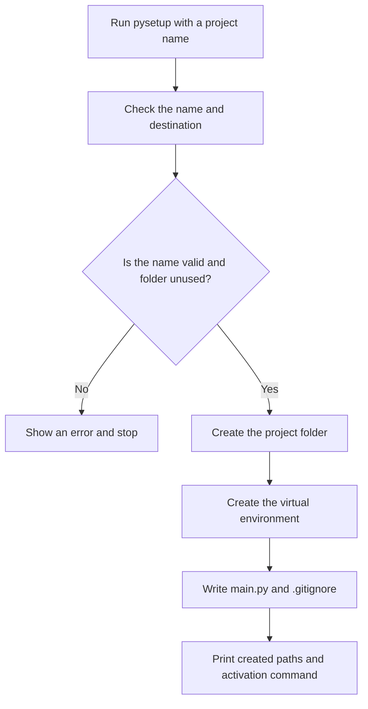

# `pysetup` — Python Project Starter

`pysetup` creates a ready-to-use Python project with one command. It makes a project folder, a virtual environment, a starter `main.py`, and a Python `.gitignore`.

```bash
pysetup myproject
```

**Team:** Swapnil Gaur (150097926057), Prajwal Mali (150097926045) 
**Repository:** https://github.com/SwapnilGaur05/pysetup-Python-Project-Starter  
**Date:** 27-10-2026

---

## 1. The problem

When starting a small Python project, we usually create a folder, make a virtual environment, add a Python file, and write a `.gitignore`. Doing these steps by hand takes time, and it is easy to forget one.

### How we do it now

Check that these commands match what you really use. Add the command you use for `.gitignore`, if applicable.

```bash
mkdir myproject
cd myproject
python3 -m venv .venv
touch main.py
```

### Evidence from our computers

Run this in your usual terminal and replace the example area with the real output. Shell history may not include every terminal session.

```bash
history | grep -E 'python3? -m venv|mkdir .*project' | wc -l
```

```text
[Paste the actual output here.]
```

We set up Python projects [how often]. Each setup takes about [time] and involves [brief description of the repeated effort].

### Who else has this problem?

Ask a classmate or teammate if they also repeat these steps. Record their real response.

**Person asked:** [Name or role]  
**Response:** [What they said]

---

## 2. Existing tools

Other tools already help create Python projects. We will compare them with `pysetup` to understand whether our small, fixed setup is useful.

### Tools to try

| Tool | What it does | What to compare |
|---|---|---|
| [`uv init`](https://docs.astral.sh/uv/guides/projects/) | Starts a new Python project. | Which files and environment does it create? How many steps are needed? |
| [Cookiecutter](https://cookiecutter.readthedocs.io/) | Creates a project from a selected template. | Is choosing and using a template useful, or more setup than this project needs? |
| [`python -m venv`](https://docs.python.org/3/library/venv.html) | Creates a Python virtual environment. | Which project files still need to be created by hand? |

### What we found when trying them

Run each tool in a temporary location. Paste your actual commands and results; do not describe a tool as tested until you have run it.

**`uv init`**

```bash
uv --version
uv init pysetup-uv-test
```

```text
[Paste the actual result and explain what it created.]
```

**Cookiecutter**

```bash
cookiecutter --version
cookiecutter <Python-template-you-selected>
```

```text
[Paste the actual result and name the template you used.]
```

**Python's built-in `venv`**

```bash
mkdir pysetup-venv-test
python3 -m venv pysetup-venv-test/.venv
```

```text
[Paste the actual result. Say which files you still had to create.]
```

### Where we searched

Check these boxes only after doing the searches. Add the search terms and a short summary of what you found.

- [ ] Local manual pages: `man -k python` — [results]
- [ ] GitHub — [search terms and useful results]
- [ ] Homebrew — [search terms and useful results]
- [ ] Stack Overflow — [search terms and useful results]
- [ ] PyPI — [search terms and useful results]
- [ ] Asked another person — [who and what they said]

### The gap we want to address

Complete this sentence after trying the tools above. If a tool already solves the problem, change the project scope instead of claiming otherwise.

> Existing tools can ____________________, but ____________________ still takes several manual steps for our use case.

---

## 3. What `pysetup` will do

### Included

- Take one project name, for example `pysetup myproject`.
- Create a folder with that name in the current directory.
- Create a `.venv` virtual environment inside the folder, using the same Python interpreter that runs `pysetup`.
- Add a runnable `main.py` and a `.gitignore` for common Python-generated files.
- Print the created files and the command to activate the virtual environment.
- Refuse to overwrite an existing folder.

The starter file will print:

```text
Hello from myproject!
```

The `.gitignore` will include:

```gitignore
.venv/
__pycache__/
*.py[cod]
```

The project name must be one folder name, not a path. Reject an empty name, `.` or `..`, absolute paths, and names containing path separators. Project creation will not install extra packages or need an internet connection.

### Not included

- Installing third-party packages or managing project dependencies.
- Creating a full application, test suite, license, or CI pipeline.
- Replacing or changing an existing project.
- Supporting custom templates or many configuration options.

### How we will know it works

From a temporary directory, one `pysetup myproject` command should create `myproject/` with `.venv/`, `main.py`, and `.gitignore`. Running `main.py` with the new environment's Python should print the greeting above.

### Acceptance checks

| Test | Expected result |
|---|---|
| Create a project in a temporary directory | The named folder appears in that directory. |
| Check the new project | It contains `.venv/`, `main.py`, and `.gitignore`. |
| Run `main.py` with the new environment's Python | It prints `Hello from myproject!` and exits successfully. |
| Create the same project a second time | `pysetup` reports that the folder exists and does not change it. |
| Use a missing or invalid name | `pysetup` shows an error and does not create a project outside the current directory. |
| A setup step fails | `pysetup` reports the failure and does not say the project was successfully created. |

---

## 4. Technology choices

| Part | Choice | Why |
|---|---|---|
| Language | Python | It is the language of the projects being created and includes tools for creating virtual environments. |
| Command-line arguments | `argparse` | It is built into Python and handles the project name and `--help` option. |
| Dependencies | Python standard library | The starter tool does not need third-party packages. |
| Tests | `unittest` and temporary directories | They are built in and let us test without changing real projects. |
| Installation | Python package with a `pysetup` command | Installing the package should make `pysetup <name>` available in the terminal. The package metadata and installation steps still need to be implemented and tested. |

We chose Python because the tool creates Python projects and can use Python's built-in `venv` module. A shell script could do some of the same work, but shell commands differ between operating systems. Python should make it easier to provide one consistent command across platforms.

We are not using a framework or extra library because the tool has a small job. We will create the environment and files locally; we will not download packages or project templates.

---

## 5. How it works



### Main parts

These are the planned files; update the names if the implementation uses a different layout.

| File | Job |
|---|---|
| `pysetup/cli.py` | Reads the command and project name, then reports errors or success. |
| `pysetup/generator.py` | Creates the folder, virtual environment, and starter files. |
| `pyproject.toml` | Defines how to install the `pysetup` command. |
| `tests/test_pysetup.py` | Tests the generated project and error cases. |

### What goes in and what comes out

The user gives `pysetup` a project name. The tool checks that the name is safe and the folder does not already exist. It creates the project files locally and prints their locations and an activation command.

### If something goes wrong

| Problem | What `pysetup` should do |
|---|---|
| The name is missing or invalid | Explain the problem, show usage, and exit with code `2`. |
| The folder already exists | Do not overwrite it; explain the problem and exit with code `2`. |
| Python cannot create the environment or a file cannot be written | Report the failing step and exit with code `1`. If a partial folder remains, show its location. |

---

## 6. Using `pysetup`

### Command

```text
pysetup <project-name>
```

The project name is required. `-h` or `--help` shows usage information.

### Example: create a project

Run this from the directory where you want the new project folder:

```bash
pysetup myproject
```

Example output (replace it with the real output after implementation):

```text
Created project: myproject
Virtual environment: myproject/.venv
Starter file: myproject/main.py
Git ignore file: myproject/.gitignore
Activate with: source myproject/.venv/bin/activate
```

The activation command shown is for macOS/Linux. On Windows, use the command for your shell:

```powershell
# PowerShell
myproject\.venv\Scripts\Activate.ps1
```

```bat
:: Command Prompt
myproject\.venv\Scripts\activate.bat
```

### Example: run the starter file

On macOS/Linux:

```bash
cd myproject
source .venv/bin/activate
python main.py
```

Expected output:

```text
Hello from myproject!
```

On Windows, activate the environment using the matching command above, then run `python main.py`.

### Example: folder already exists

```bash
pysetup myproject
```

```text
Error: project directory 'myproject' already exists; choose a different name.
```

This is example text. Replace it with the exact error printed by the finished tool.

### Exit codes

| Code | Meaning |
|---|---|
| `0` | Project created or help displayed. |
| `1` | A file or virtual-environment setup failed. |
| `2` | The name is invalid or the project folder already exists. |

### Installation

These are proposed development-install steps. They work only after the package metadata and `pysetup` command have been implemented. Test them in a clean checkout before presenting them as final.

On macOS/Linux:

```bash
git clone https://github.com/SwapnilGaur05/pysetup-Python-Project-Starter
cd pysetup-Python-Project-Starter
python3 -m venv .venv
source .venv/bin/activate
python -m pip install .
pysetup --help
```

On Windows, create and activate the environment before installing:

```powershell
git clone https://github.com/SwapnilGaur05/pysetup-Python-Project-Starter
cd pysetup-Python-Project-Starter
py -m venv .venv
.\.venv\Scripts\Activate.ps1
python -m pip install .
pysetup --help
```

---

## 7. References

- [Python `venv` documentation](https://docs.python.org/3/library/venv.html) — explains how Python creates virtual environments.
- [Python `argparse` documentation](https://docs.python.org/3/library/argparse.html) — explains Python's built-in command-line argument parser.
- [uv project guide](https://docs.astral.sh/uv/guides/projects/) — describes `uv init`, one tool to compare with `pysetup`.
- [Cookiecutter documentation](https://cookiecutter.readthedocs.io/) — describes template-based project generation.

Add any other sources you actually read or tools you tried, with a short note about what you learned.
